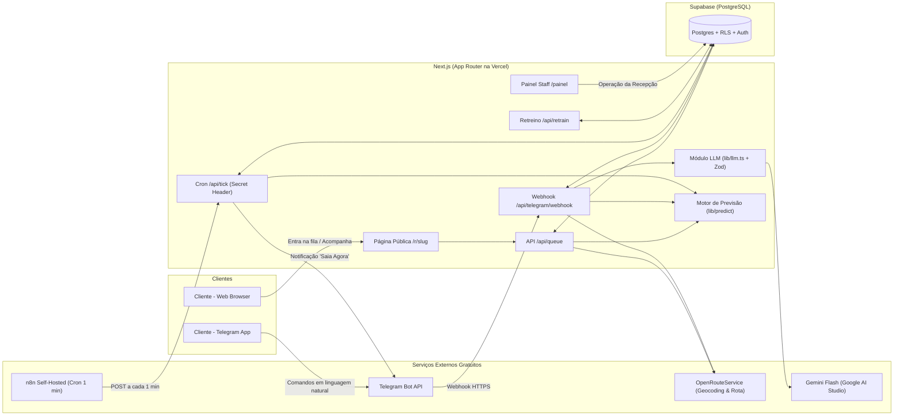
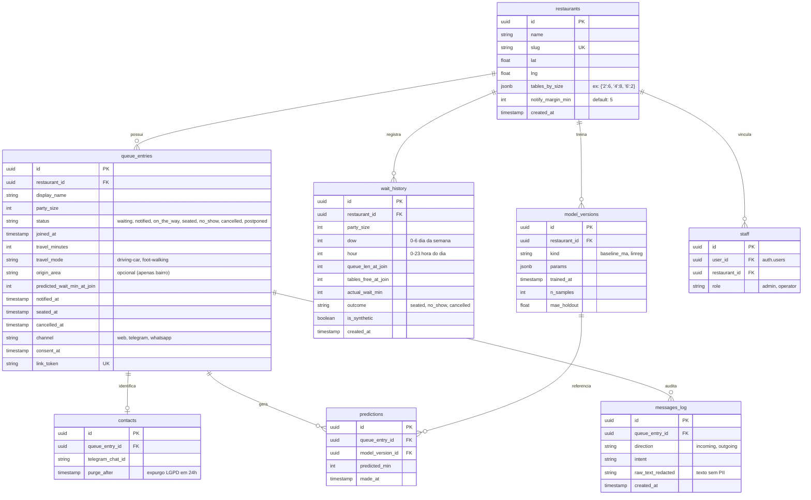

# Plano de Implementação — Projeto 1: Fila Inteligente com Rota
> **Especificação extraída do documento:** *Portfólio IA Builder iFood – Planos dos 3 projetos* (Seção 4: Projeto 1 — Fila Inteligente com Rota)  
> **Prioridade:** #1 do Portfólio  
> **Estimativa Total:** ~21 a 31 horas  
> **Alvo:** Sistema completo em produção, portfólio no GitHub, documentação de ROI e vídeo demonstrativo de 90s.

---

## 1. Visão Geral e Proposta de Valor

### 1.1 O Problema
Restaurantes cheios geram superlotação física na porta, espera desconfortável para os clientes, recepcionistas sobrecarregados anotando nomes em pranchetas/papel e alta taxa de desistência silenciosa (*walkouts* e *no-shows*).

### 1.2 A Solução: Fila Inteligente com Rota
O cliente entra na fila virtual diretamente de casa pelo navegador ou Telegram, informando o número de pessoas e sua localização/endereço. A plataforma:
1. **Calcula o tempo de deslocamento** em tempo real via OpenRouteService (carro ou a pé).
2. **Prevê o tempo de espera real** na mesa através de um modelo estatístico explicável (regra de negócio $\to$ média móvel hierárquica $\to$ regressão linear/ridge com histórico sintético que aprende).
3. **Dispara o alerta pró-ativo "🚗 Saia agora!"** pelo Telegram no instante exato em que o tempo de espera coincide com o tempo de deslocamento até o restaurante.
4. **Agente Conversacional com Google Gemini:** processa mensagens em linguagem natural (ex: *"somos 4, chego em 20 min"*, *"me passa pra depois"*, *"quanto tempo falta?"*, *"cancelar"*), mantendo a interpretação com IA e a execução 100% determinística em código.
5. **Painel Operacional e Estratégico:** visão em tempo real para a recepção chamar/acompanhar mesas e dashboard executivo com métricas reais de impacto (espera média, taxa de desistência, horários de pico, economia de horas da equipe e redução do erro MAE da previsão).
6. **Privacidade e LGPD por Design:** endereço e coordenadas geográficas do cliente **nunca** são persistidos no banco de dados, e contatos do Telegram são expurgados em 24h.

---

## 2. Arquitetura da Solução



---

## 3. Stack Tecnológica (100% Camadas Gratuitas)

| Componente | Ferramenta / Serviço | Justificativa Técnica |
|---|---|---|
| **Frontend & API** | Next.js 14/15 (App Router) + TypeScript + TailwindCSS | SSR/SSG rápido, rotas de API serverless na Vercel Hobby, tipagem estrita. |
| **Banco de Dados & Auth** | Supabase (PostgreSQL Free Tier) | Banco relacional robusto, Row Level Security (RLS), autenticação nativa de staff. |
| **Geolocalização & Rotas** | OpenRouteService API (Plano Gratuito) | Geocodificação reversa e rotas precisas de carro e a pé sem necessidade de cartão de crédito. |
| **Inteligência Artificial** | Google Gemini API (Google AI Studio - Gemini Flash) | Camada gratuita, alta velocidade de inferência, suporte nativo a JSON estruturado com Zod. |
| **Mensageria** | Telegram Bot API | Comunicação bidirecional sem custo, botões inline, notificações instantâneas com webhook seguro. |
| **Orquestração / Cron** | n8n (Self-Hosted) ou Supabase pg_cron | Disparo periódico do tick de 1 minuto sem esbarrar nas limitações do cron da Vercel Hobby. |
| **Visualização de Dados** | Recharts | Gráficos responsivos de métricas, MAE e mapas de calor no painel. |
| **Testes e Qualidade** | Vitest + ESLint + Prettier | Execução ultra-rápida de testes unitários de lógica de negócio e validação estática. |

---

## 4. Modelo de Dados (Supabase / PostgreSQL)

### 4.1 Tabelas e Especificações



> **Aviso de Privacidade (LGPD):** A tabela `queue_entries` **NUNCA** armazena endereço residencial nem coordenadas exatas (`lat`/`lng`) do cliente. Apenas `travel_minutes` e opcionalmente o nome do bairro (`origin_area`).

---

## 5. Divisão Detalhada em Tarefas (Fases 0 a 8)

### Fase 0: Setup, Estrutura e Governança do Projeto
**Tempo Estimado:** 1–2 horas  
**Objetivo:** Criar o esqueleto do projeto Next.js com todas as ferramentas de qualidade, ambiente validado e pipeline de CI.

- [ ] **Tarefa 0.1:** Inicializar o projeto Next.js (App Router) com TypeScript estrito, TailwindCSS, ESLint, Prettier e Vitest.
- [ ] **Tarefa 0.2:** Configurar scripts do `package.json`: `dev`, `build`, `lint`, `typecheck`, `test`.
- [ ] **Tarefa 0.3:** Criar e configurar o validador de variáveis de ambiente com Zod em `lib/env.ts` (lança erro legível se faltar variável obrigatória) e criar `.env.example`.
- [ ] **Tarefa 0.4:** Implementar cliente singleton do Supabase (`lib/supabase/client.ts` e `lib/supabase/server.ts`).
- [ ] **Tarefa 0.5:** Criar esqueleto do wrapper LLM em `lib/llm.ts` configurável por `GEMINI_MODEL`.
- [ ] **Tarefa 0.6:** Criar endpoint `GET /api/health` retornando `{ ok: true, timestamp }`.
- [ ] **Tarefa 0.7:** Configurar GitHub Actions (`.github/workflows/ci.yml`) para rodar lint, typecheck e testes.
- [ ] **Tarefa 0.8:** Criar documentações iniciais: `docs/DECISIONS.md`, `docs/PRIVACY.md` e `README.md` introdutório.

**Critérios de Aceite:**
- `npm run build`, `npm run lint`, `npm run typecheck` e `npm test` passam com sucesso.
- `GET /api/health` responde status 200.
- Teste unitário garante que `lib/env.ts` rejeita inicialização sem variáveis críticas.

---

### Fase 1: Fila Básica, Banco de Dados & Painel Operacional
**Tempo Estimado:** 2–3 horas  
**Objetivo:** Permitir que o cliente entre na fila via formulário público web e que o restaurante veja e atenda a fila no painel.

- [ ] **Tarefa 1.1:** Criar migração SQL inicial do Supabase com as tabelas completas, enums de status e canal, chaves estrangeiras e índices.
- [ ] **Tarefa 1.2:** Configurar políticas de segurança RLS (Row Level Security):
  - Acesso anônimo apenas para criação via API e leitura restrita por `link_token`.
  - Acesso de leitura/atualização irrestrito para membros autenticados de `staff`.
- [ ] **Tarefa 1.3:** Criar script/seed de dados para o restaurante de demonstração (*"Cantina Demo"*, Curitiba, capacidade: `{"2":6,"4":8,"6":2}`).
- [ ] **Tarefa 1.4:** Implementar função determinística de cálculo de posição na fila em `lib/queue/position.ts` (considerando agrupamentos compatíveis com tamanho de mesa) com suíte de testes Vitest (mínimo de 6 cenários).
- [ ] **Tarefa 1.5:** Criar página pública de entrada na fila `/r/[slug]/page.tsx` com formulário (apelido, tamanho do grupo 1–12 e checkbox obrigatório de consentimento LGPD).
- [ ] **Tarefa 1.6:** Implementar rota `POST /api/queue` que insere em `queue_entries` com status `waiting` e gera o `link_token`.
- [ ] **Tarefa 1.7:** Criar página do cliente `/r/[slug]/e/[token]/page.tsx` exibindo status em tempo real, posição atualizada a cada 15 segundos e botão de desistência.
- [ ] **Tarefa 1.8:** Implementar painel operacional inicial `/painel` listando a fila em tempo real com ações imediatas: *"Sentou"*, *"Não veio"* e *"Cancelar"*, registrando o atendimento em `wait_history` com `actual_wait_min = seated_at - joined_at`.

**Critérios de Aceite:**
- Migração aplica do zero sem inconsistências.
- Testes unitários de posição compatível passam com 100% de cobertura.
- Fluxo ponta a ponta funcional: cliente entra na fila $\to$ surge no painel $\to$ operador clica em "Sentou" $\to$ registro gravado em `wait_history`.

---

### Fase 2: Roteamento com OpenRouteService & Garantia LGPD
**Tempo Estimado:** 2–3 horas  
**Objetivo:** Integrar cálculo de tempo de deslocamento sem armazenar dados pessoais sensíveis de localização.

- [ ] **Tarefa 2.1:** Implementar cliente ORS em `lib/routing/ors.ts`:
  - `geocode(address)`: busca no endpoint `/geocode/search` com restrição de país (`boundary.country=BR`) e foco nas coordenadas do restaurante, retornando latitude, longitude e nome do bairro.
  - `travelMinutes(origin, destination, mode)`: calcula tempo em minutos via `/v2/directions` (carro ou a pé) arredondado para cima.
  - Adicionar timeout de 8 segundos, política de 2 retries com backoff e cache em memória (TTL de 10 min) indexado por coordenadas aproximadas.
- [ ] **Tarefa 2.2:** Adicionar no formulário público a opção de preencher endereço ou utilizar botão *"Usar minha localização"* via API do navegador (`navigator.geolocation`).
- [ ] **Tarefa 2.3:** Disponibilizar alternativa manual *"Já estou a X minutos do local"* para quem não deseja informar localização.
- [ ] **Tarefa 2.4:** Atualizar a rota `POST /api/queue` para calcular `travel_minutes` e descartar as coordenadas e endereço completo imediatamente em memória.
- [ ] **Tarefa 2.5:** Escrever teste unitário validando que o payload final gravado em banco **não** possui endereço, rua, número ou coordenadas do cliente.
- [ ] **Tarefa 2.6:** Criar página pública `/privacidade` detalhando conformidade com a LGPD (Art. 7º, I), finalidade de uso e ciclo de descarte.

**Critérios de Aceite:**
- Testes com mocks do OpenRouteService cobrem sucesso, endereço inexistente e timeout de rede.
- Prova nos testes automatizados de que endereço e coordenadas não são persistidos.
- Rodapé de todas as páginas públicas com link acessível para `/privacidade`.

---

### Fase 3: Motor de Previsão de Espera que Aprende
**Tempo Estimado:** 3–5 horas  
**Objetivo:** Construir e treinar modelos de previsão explicáveis e comparáveis (Baseline de Regra, Média Móvel e Regressão Linear Regularizada).

- [ ] **Tarefa 3.1:** Criar gerador de histórico sintético em `scripts/seed-history.ts` simulando ~6 semanas de movimentação com chegadas de Poisson (picos almoço 12–14h e jantar 19–22h), tempos de giro realistas por tamanho de mesa e semente aleatória fixa (`seedrandom`).
- [ ] **Tarefa 3.2:** Implementar extrator de features em `lib/predict/features.ts`: posição relativa, grupos à frente, tamanho da mesa (one-hot), dia da semana, codificação cíclica de hora (seno/cosseno) e giro médio recente.
- [ ] **Tarefa 3.3:** Implementar modelos determinísticos em TypeScript puro:
  - **Baseline A (`baselineRule.ts`):** $\text{Espera} \approx \frac{\text{grupos compatíveis}}{\text{mesas}} \times \text{giro médio}$.
  - **Baseline B (`baselineMA.ts`):** média móvel agrupada por dia da semana $\times$ faixa horária $\times$ tamanho de grupo com fallback hierárquico.
  - **Modelo C (`linreg.ts`):** regressão linear com regularização Ridge implementada via equações normais em TypeScript.
- [ ] **Tarefa 3.4:** Implementar rotina de validação temporal (`evaluate.ts`): treina nas primeiras semanas e avalia nos últimos 7 dias (*holdout*), calculando MAE e RMSE.
- [ ] **Tarefa 3.5:** Implementar rota de retreino `POST /api/retrain` (protegida por `TICK_SECRET`) que grava nova linha em `model_versions` se o MAE superar o anterior.
- [ ] **Tarefa 3.6:** Criar script `scripts/evaluate.ts` que executa os 3 modelos, compara com dados de teste e gera automaticamente a tabela de métricas em `docs/EVAL.md`.

**Critérios de Aceite:**
- Teste unitário do algoritmo de regressão recupera coeficientes de equação sintética com erro inferior a 0.1.
- `scripts/evaluate.ts` executa em menos de 30 segundos gerando `docs/EVAL.md`.
- Na entrada da fila, a predição é salva em `predictions` vinculada à versão do modelo.

---

### Fase 4: Telegram, Notificação "Saia Agora" e Motor de Tick
**Tempo Estimado:** 3–4 horas  
**Objetivo:** Notificar o cliente de forma proativa via Telegram no exato momento de sair de casa e gerenciar o ciclo de vida da fila.

- [ ] **Tarefa 4.1:** Implementar cliente do Telegram em `lib/channels/telegram.ts` (envio de mensagens formatadas em HTML com botões interativos inline: *"Estou a caminho"*, *"Me passa pra depois"*, *"Cancelar"*).
- [ ] **Tarefa 4.2:** Implementar rota `POST /api/telegram/webhook` com validação de assinatura (`X-Telegram-Bot-Api-Secret-Token`).
- [ ] **Tarefa 4.3:** Tratar o comando `/start <link_token>`: vincula o `chat_id` à entrada na tabela `contacts` (com data de expurgo `purge_after = now() + 24h`) e responde com a posição atual e tempo previsto.
- [ ] **Tarefa 4.4:** Adicionar na tela web `/r/[slug]/e/[token]` o botão interativo *"Receber aviso no Telegram"* com deep link `https://t.me/<BOT_USERNAME>?start=<link_token>`.
- [ ] **Tarefa 4.5:** Implementar o endpoint agendado `POST /api/tick` (autenticado via header `x-tick-secret`):
  - Recalcula a espera restante para entradas em estado `waiting`.
  - Dispara a notificação *"🚗 Saia agora! Sua mesa deve liberar em ~X min e você leva ~Y min"* quando $\text{espera restante} - \text{tempo deslocamento} \le \text{margem}$ (padrão 5 min).
  - Garante idempotência e proteção contra disparos duplicados via lock transacional (`UPDATE ... WHERE notified_at IS NULL RETURNING`).
  - Dispara lembrete após 5 minutos sem confirmação.
  - Executa limpeza LGPD apagando contatos cujo `purge_after` expirou.
- [ ] **Tarefa 4.6:** Criar template do workflow n8n em `n8n/tick-workflow.json` e documentação de configuração em `docs/N8N_TICK.md` (Schedule de 1 min para tick e cron das 04:00 para retreino).

**Critérios de Aceite:**
- Chamar `/api/tick` em sequência não envia notificações duplicadas.
- Testes unitários cobrem cenários: cedo demais, no momento exato, atrasado e já notificado.
- Expurgo de contatos com mais de 24 horas comprovado por teste automatizado.

---

### Fase 5: Agente Conversacional com Google Gemini
**Tempo Estimado:** 3–4 horas  
**Objetivo:** Permitir interação humanizada no Telegram com IA para entender intenções do cliente, com ações 100% determinísticas e fallback resiliente.

- [ ] **Tarefa 5.1:** Implementar módulo central `lib/llm.ts` integrado ao SDK do Gemini com:
  - Validação estrita de schema JSON de saída via Zod.
  - Timeout de requisição e retry com backoff exponencial.
  - Registro de tokens consumidos e latência.
- [ ] **Tarefa 5.2:** Criar classificador de intenções em `lib/agent/intents.ts` categorizando mensagens em:
  - `join_queue { party_size, eta_minutes, name }`
  - `update_eta { eta_minutes }`
  - `postpone { minutes }`
  - `cancel {}`
  - `status {}`
  - `help {}` / `other {}`
- [ ] **Tarefa 5.3:** Criar prompt do sistema com técnica few-shot contendo 10+ exemplos em português coloquial (*"somos 4, chego em 20 min"*, *"atrasei uns 10"*, *"passa pra depois"*, *"quanto falta?"*).
- [ ] **Tarefa 5.4:** Implementar executor de ações determinístico em `lib/agent/actions.ts`:
  - Ação `postpone`: recua o cliente N posições compatíveis e reinicia o estado de notificação.
  - Ação `cancel`: encerra a entrada no banco.
  - Ação `status`: consulta dados reais do modelo de previsão.
- [ ] **Tarefa 5.5:** Implementar camada de fallback por Regex em `lib/agent/fallback.ts`: se o Gemini retornar status 429 (cota esgotada) ou erro de conexão, expressões regulares extraem números e intenções básicas sem interrupção do serviço.
- [ ] **Tarefa 5.6:** Sanitização e mascaramento de dados sensíveis antes de gravar histórico em `messages_log`.
- [ ] **Tarefa 5.7:** Criar suíte de testes `tests/agent/intents.spec.ts` com 25 frases coloquiais e script `scripts/eval-intents.ts` para homologação de acurácia com a API real do Gemini.

**Critérios de Aceite:**
- Acurácia $\ge 90\%$ na suíte de 25 frases de teste no `scripts/eval-intents.ts`.
- Fallback por regex ativado com sucesso caso a chave do Gemini esteja indisponível.
- Nenhuma ação é executada caso a resposta não passe na validação Zod.

---

### Fase 6: Painel do Restaurante & Métricas de Negócio
**Tempo Estimado:** 3–4 horas  
**Objetivo:** Entregar uma interface gerencial e operacional completa para os operadores do restaurante e tomada de decisão.

- [ ] **Tarefa 6.1:** Configurar autenticação de operadores via Supabase Auth em `/painel/login` e proteger rotas no `middleware.ts` com verificação na tabela `staff`.
- [ ] **Tarefa 6.2:** Desenvolver a aba operacional **"Agora"**:
  - Lista da fila ao vivo atualizada automaticamente (via polling de 10s ou Supabase Realtime).
  - Informações por cliente: apelido, tamanho do grupo, status visual colorido, tempo de deslocamento, tempo de espera previsto e tempo decorrido desde a notificação.
  - Ações rápidas com um clique: *Chamar Agora*, *Sentou*, *Não Veio*, *Cancelar*.
- [ ] **Tarefa 6.3:** Desenvolver a aba gerencial **"Métricas"** com gráficos Recharts:
  - Tempo médio de espera diário vs. histórico semanal.
  - Taxa de desistência (*cancelled*) e taxa de *no-show*.
  - Mapa de calor de horários de pico (dia da semana $\times$ faixa de horário).
  - Gráfico de linha temporal com a evolução do MAE do modelo a cada retreino.
  - Histograma de distribuição do tamanho dos grupos.
- [ ] **Tarefa 6.4:** Implementar o card de ROI: *"Minutos de recepção economizados"*:
  $$\text{Minutos Economizados} = (\text{notificações automáticas} \times 1.5\,\text{min}) + (\text{respostas do bot} \times 1.0\,\text{min})$$
  (Permitir ajuste de premissas nas configurações da tela).
- [ ] **Tarefa 6.5:** Criar endpoint `GET /api/metrics?from&to` para consulta programática de todos os indicadores.
- [ ] **Tarefa 6.6:** Garantir layout responsivo otimizado para tablets e celulares da equipe de atendimento.

**Critérios de Aceite:**
- Página do painel carrega e renderiza em $< 2$ segundos mesmo com centenas de entradas no histórico.
- Usuários não autorizados recebem redirecionamento ou status 403 Forbidden.
- Cálculos matemáticos das métricas cobertos por testes unitários com valores fixos de amostragem.

---

### Fase 7: Deploy em Produção & Verificação de Fumaça
**Tempo Estimado:** 1–2 horas  
**Objetivo:** Publicar toda a infraestrutura na nuvem (Vercel, Supabase, n8n, Telegram) e validar a integridade ponta a ponta.

- [ ] **Tarefa 7.1:** Escrever o guia de implantação em `docs/DEPLOY.md` com o checklist de configuração das variáveis de ambiente.
- [ ] **Tarefa 7.2:** Criar projeto na Vercel conectado ao repositório GitHub e configurar as variáveis de produção.
- [ ] **Tarefa 7.3:** Executar migrações e seed no projeto de produção do Supabase.
- [ ] **Tarefa 7.4:** Configurar webhook oficial no Telegram através do script `scripts/set-webhook.ts`.
- [ ] **Tarefa 7.5:** Configurar e ativar o workflow no n8n chamando o endpoint `/api/tick` de produção a cada 1 minuto.
- [ ] **Tarefa 7.6:** Implementar script de verificação automatizada `scripts/smoke.ts` que testa em produção:
  - `GET /api/health`
  - `GET /api/metrics`
  - Criação de entrada de teste temporária $\to$ execução do tick $\to$ alteração para "Sentou" $\to$ expurgo do teste.
- [ ] **Tarefa 7.7:** Configurar headers de segurança no `next.config.mjs` (CSP, HSTS, X-Frame-Options) e rate limiting preventivo por IP nas rotas públicas.

**Critérios de Aceite:**
- `scripts/smoke.ts` executa sem erros contra a URL final de produção na Vercel.
- O bot oficial do Telegram responde em tempo real.
- Usuário de demonstração com permissões somente leitura configurado para avaliadores.

---

### Fase 8: Avaliação Final, README de Portfólio & Materiais
**Tempo Estimado:** 3–4 horas  
**Objetivo:** Consolidar a documentação de impacto de negócio, métricas transparentes, vídeo de 90 segundos e post de apresentação.

- [ ] **Tarefa 8.1:** Consolidar os resultados de benchmark em `docs/EVAL.md`:
  - Tabela comparativa de MAE: Regra vs Média Móvel vs Regressão Linear.
  - Impacto na taxa de desistência (cenário simulado sem aviso vs com aviso "saia agora").
  - Acurácia medida do agente conversacional.
- [ ] **Tarefa 8.2:** Construir o `README.md` final do projeto contendo:
  - Pitch do problema e proposta de valor.
  - Link da demo em produção e credenciais de acesso ao painel.
  - Diagrama de arquitetura mermaid.
  - Tabela de ROI e impacto com etiquetas explícitas (`[medido]`, `[simulado]`, `[estimativa]`).
  - Seção de limitações honestas (ex: ORS não contempla trânsito em tempo real; histórico inicial gerado sinteticamente).
  - Guia de execução local passo a passo.
- [ ] **Tarefa 8.3:** Roteirizar e produzir o vídeo demonstrativo de 90 segundos seguindo o roteiro oficial (Gravação com ferramenta gratuita como Loom/OBS).
- [ ] **Tarefa 8.4:** Redigir rascunho do post no LinkedIn destacando as decisões técnicas de engenharia, a separação de lógica determinística vs IA e o impacto no dia a dia dos restaurantes.

**Critérios de Aceite:**
- Todo número citado no README possui sua origem devidamente rotulada.
- README possui link funcional para o vídeo e para a aplicação no ar.

---

## 6. Cronograma de Execução

```mermaid
gantt
    title Cronograma Estimado de Execução — Fila Inteligente com Rota
    dateFormat  YYYY-MM-DD
    section Fundação
    Fase 0: Setup, Governança e CI           :f0, 2026-11-12, 1d
    Fase 1: Fila Básica, Banco e Painel Cru  :f1, after f0, 1d
    section Inteligência & Integrações
    Fase 2: Roteamento ORS e LGPD            :f2, after f1, 1d
    Fase 3: Motor de Previsão que Aprende    :f3, after f2, 1d
    Fase 4: Telegram, Notificação e Tick     :f4, after f3, 1d
    Fase 5: Agente Conversacional Gemini     :f5, after f4, 1d
    section Entrega & Portfólio
    Fase 6: Painel Staff e Métricas          :f6, after f5, 1d
    Fase 7: Deploy em Produção e Smoke Test  :f7, after f6, 1d
    Fase 8: Avaliação, README, Vídeo e Post  :f8, after f7, 1d
```

| Fase | Descrição | Esforço Estimado |
|---|---|---|
| **Fase 0** | Setup, Next.js, Zod Env, Supabase Client, CI | 1–2 horas |
| **Fase 1** | Migrações, RLS, Fila Web, Posição por Mesa | 2–3 horas |
| **Fase 2** | OpenRouteService, Cálculo de Rota, LGPD | 2–3 horas |
| **Fase 3** | Histórico Sintético, Modelos, Ridge, Retreino | 3–5 horas |
| **Fase 4** | Bot Telegram, Webhook, Saia Agora, n8n Tick | 3–4 horas |
| **Fase 5** | Agente Gemini, Ações Determinísticas, Fallback Regex | 3–4 horas |
| **Fase 6** | Auth Staff, Fila ao Vivo, Gráficos Recharts, ROI | 3–4 horas |
| **Fase 7** | Deploy Vercel, Supabase, n8n, Smoke Tests | 1–2 horas |
| **Fase 8** | Benchmark EVAL, README com ROI, Vídeo 90s, LinkedIn | 3–4 horas |
| **Total** | **Implementação Completa do MVP** | **~21 a 31 horas** |

---

## 7. Estrutura de Arquivos Planejada

```text
fila-inteligente/
├── .github/
│   └── workflows/
│       └── ci.yml                   # Lint, Typecheck e Vitest em pushes/PRs
├── app/
│   ├── (public)/
│   │   ├── r/
│   │   │   └── [slug]/
│   │   │       ├── page.tsx         # Formulário público de entrada na fila
│   │   │       └── e/[token]/
│   │   │           └── page.tsx     # Acompanhamento ao vivo da posição pelo cliente
│   │   ├── privacidade/
│   │   │   └── page.tsx             # Termos de privacidade e conformidade LGPD
│   │   └── layout.tsx
│   ├── (staff)/
│   │   ├── painel/
│   │   │   ├── login/page.tsx       # Login de operadores e recepcionistas
│   │   │   └── page.tsx             # Painel operacional ("Agora") e gerencial ("Métricas")
│   │   └── layout.tsx
│   ├── api/
│   │   ├── health/route.ts          # Healthcheck
│   │   ├── queue/route.ts           # Entrada e consulta de fila
│   │   ├── retrain/route.ts         # Endpoint de retreino do modelo
│   │   ├── tick/route.ts            # Motor de verificação de notificações (1 min)
│   │   ├── metrics/route.ts         # API de métricas consolidadas
│   │   └── telegram/
│   │       └── webhook/route.ts     # Webhook para mensagens do Telegram
│   ├── globals.css
│   └── layout.tsx
├── config/
│   └── simulation.json              # Parâmetros da simulação de clientes e mesas
├── docs/
│   ├── DECISIONS.md                 # Registro de decisões técnicas de arquitetura
│   ├── PRIVACY.md                   # Diretrizes detalhadas de conformidade LGPD
│   ├── N8N_TICK.md                  # Manual do agendador no n8n
│   ├── DEPLOY.md                    # Manual passo a passo de publicação
│   ├── DEMO.md                      # Roteiro de gravação do vídeo de demonstração
│   └── EVAL.md                      # Relatório dos experimentos e benchmarks
├── lib/
│   ├── agent/
│   │   ├── actions.ts               # Execução determinística de ações da fila
│   │   ├── fallback.ts              # Fallback por regex quando cota do LLM expirar
│   │   ├── intents.ts               # Schema Zod e classificação de intenções
│   │   └── prompt.ts                # System prompt com few-shot em pt-BR
│   ├── channels/
│   │   └── telegram.ts              # Cliente da Telegram Bot API com botões inline
│   ├── llm.ts                       # Wrapper do Gemini com retry, timeout e Zod
│   ├── env.ts                       # Validação rigorosa de variáveis com Zod
│   ├── predict/
│   │   ├── baselineMA.ts            # Baseline por média móvel hierárquica
│   │   ├── baselineRule.ts          # Baseline por regra determinística de giro
│   │   ├── evaluate.ts              # Cálculo de MAE e RMSE em split temporal
│   │   ├── features.ts              # Engenharia de atributos (one-hot, sen/cos)
│   │   └── linreg.ts                # Regressão Linear Ridge em TypeScript puro
│   ├── queue/
│   │   └── position.ts              # Cálculo determinístico de posição por tamanho de mesa
│   ├── routing/
│   │   └── ors.ts                   # Cliente OpenRouteService com cache em memória
│   └── supabase/
│       ├── client.ts                # Cliente Supabase para navegador
│       └── server.ts                # Cliente Supabase com Service Role para API
├── n8n/
│   └── tick-workflow.json           # Workflow importável do n8n para agendamento
├── scripts/
│   ├── evaluate.ts                  # Executa benchmark e atualiza docs/EVAL.md
│   ├── eval-intents.ts              # Avalia acurácia de intenções contra o Gemini real
│   ├── seed-history.ts              # Gera dados sintéticos realistas no Supabase
│   ├── set-webhook.ts               # Registra webhook do Telegram na API oficial
│   └── smoke.ts                     # Teste de fumaça ponta a ponta em produção
├── supabase/
│   └── migrations/                  # Arquivos SQL versionados de tabelas e RLS
├── tests/
│   ├── agent/intents.spec.ts        # Testes de interpretação e ações do bot
│   ├── predict/linreg.spec.ts       # Testes da regressão linear e métricas
│   ├── queue/position.spec.ts       # Testes do algoritmo de ordenação de mesas
│   └── routing/ors.spec.ts          # Testes de geocodificação e rota com mocks
├── .env.example                     # Modelo de variáveis de ambiente necessárias
├── AGENTS.md                        # Regras do projeto e conduta para agentes de código
├── package.json
├── tailwind.config.ts
├── tsconfig.json
└── vitest.config.ts
```

---

## 8. Matriz de Avaliação (EVAL) e Modelo de Tabela de ROI

A apresentação final no `README.md` conterá dados comprobatórios baseados em evidências:

| Indicador de Negócio | Antes (Processo Manual / Baseline) | Depois (Fila Inteligente) | Tipo do Dado | Fonte da Evidência |
|---|---|---|---|---|
| **Erro Médio da Previsão (MAE)** | `__ min` (Regra de Giro Simples) | `__ min` (Regressão Treinada) | `[medido]` | `docs/EVAL.md` |
| **Erro em Uso Real** | — | `__ min` ($n = \text{\_\_}$) | `[medido]` | `/api/metrics` |
| **Taxa de Desistência (*Walkouts*)** | `__ %` (sem previsibilidade) | `__ %` (esperando em casa) | `[simulado]` | `docs/EVAL.md` |
| **Tempo da Recepção por Cliente** | `1.5 min` (anotar + ligar/chamar) | `0.1 min` (clique no painel) | `[estimativa]` | Card do Painel |
| **Minutos de Recepção Poupados / dia** | `0 min` | `__ min/dia` | `[estimativa]` | `/api/metrics` |
| **Acurácia do Agente Conversacional** | — | `__ %` (25 frases de teste) | `[medido]` | `docs/EVAL.md` |
| **Tempo Total de Construção do MVP** | — | `__ dias` | `[medido]` | Histórico Git |

---

## 9. Próximos Passos Imediatos

Para iniciar a implementação com foco e organização, a execução deve seguir a ordem estrita das fases:
1. **Passo 1:** Executar a **Fase 0** criando o repositório, configurando Next.js, Vitest, `.env.example`, `lib/env.ts` e garantindo o comando `npm run build && npm test`.
2. **Passo 2:** Prosseguir para a **Fase 1** criando as migrações SQL no Supabase, a lógica de posicionamento de mesas com testes unitários e as telas iniciais da fila e do painel.
