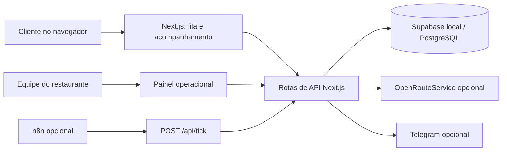

# Fila Inteligente com Rota

MVP local para organizar a fila de um restaurante. A pessoa entra pela web, acompanha sua posição e informa quanto tempo leva para chegar. A equipe acompanha as entradas em um painel operacional; com o Telegram configurado, o sistema pode avisar quando for hora de sair.

> **Estado do projeto:** protótipo em desenvolvimento. A execução local está preparada; ainda há pendências de segurança e funcionalidades antes de usar com clientes ou publicar em produção.

## O que o projeto faz

- Recebe entradas na fila por uma página pública e gera um link para acompanhar o status.
- Estima o tempo de deslocamento por endereço com OpenRouteService ou aceita o tempo informado manualmente.
- Calcula uma previsão de espera com modelos determinísticos e permite comparar o resultado com histórico sintético.
- Oferece um painel operacional para acompanhar entradas e atualizar o atendimento.
- Inclui endpoints para integração com Telegram e um processo periódico (`/api/tick`) para alertas e expurgo de contatos.
- Executa localmente com PostgreSQL, API e Studio do Supabase em Docker, sem exigir um projeto Supabase hospedado.

## Arquitetura



As previsões, a ordenação da fila e as transições de status são responsabilidade do código determinístico. A integração Gemini está apenas preparada; a interpretação de mensagens em linguagem natural ainda não foi implementada.

## Tecnologias

- Next.js 14 com App Router, React e TypeScript
- Tailwind CSS
- Supabase/PostgreSQL local via Supabase CLI e Docker
- Zod para validação
- Vitest para testes
- OpenRouteService, Telegram, Gemini e n8n como integrações opcionais

## Executar localmente

### Requisitos

- Node.js 20 ou superior
- Docker Desktop iniciado e integrado ao WSL, caso use Windows/WSL

### Iniciar o Supabase local

Instale as dependências:

```bash
npm install
```

Crie a rede local uma vez, para publicar as portas somente em `127.0.0.1`:

```bash
docker network create --opt com.docker.network.bridge.host_binding_ipv4=127.0.0.1 supabase-local-only
```

Se a rede já existir, siga para o próximo comando. Inicie o banco e os serviços locais:

```bash
npm run db:start
```

Na primeira inicialização, o Docker baixa as imagens necessárias. A migração em `supabase/migrations/` cria o esquema e os dados da Cantina Demo.

Gere o arquivo local de variáveis com as chaves que o Supabase CLI criou:

```bash
npm run db:env
```

O comando cria `.env.local`, arquivo ignorado pelo Git. Não publique esse arquivo nem use suas chaves locais em produção.

### Iniciar a aplicação

```bash
npm run dev
```

Abra:

- Aplicação: [http://localhost:3000](http://localhost:3000)
- Fila da Cantina Demo: [http://localhost:3000/r/cantina-demo](http://localhost:3000/r/cantina-demo)
- Painel operacional: [http://localhost:3000/painel](http://localhost:3000/painel)
- Supabase Studio: [http://127.0.0.1:54323](http://127.0.0.1:54323)
- Healthcheck: [http://localhost:3000/api/health](http://localhost:3000/api/health)

Mais detalhes: [docs/LOCAL_DEVELOPMENT.md](docs/LOCAL_DEVELOPMENT.md).

### Parar ou recriar o banco

```bash
npm run db:stop
```

Para recriar o banco e reaplicar as migrações:

```bash
npm run db:reset
```

**Atenção:** `db:reset` apaga os dados locais existentes.

## Integrações opcionais

As variáveis estão listadas em [`.env.example`](.env.example). Configure-as em `.env.local` apenas se for testar a integração correspondente:

- `ORS_API_KEY`: geocodificação e estimativa de rota pelo OpenRouteService.
- `TELEGRAM_BOT_TOKEN`, `TELEGRAM_BOT_USERNAME` e `TELEGRAM_WEBHOOK_SECRET`: bot e webhook do Telegram.
- `TICK_SECRET`: autenticação do endpoint periódico.
- `GEMINI_API_KEY` e `GEMINI_MODEL`: integração Gemini, ainda sem o agente conversacional completo.

Sem essas credenciais, o projeto possui fallbacks locais para algumas integrações. Esses fallbacks servem para desenvolvimento e não representam chamadas reais a serviços externos.

O workflow do n8n está em `n8n/tick-workflow.json`; instruções adicionais estão em [docs/N8N_TICK.md](docs/N8N_TICK.md).

## Testes e qualidade

```bash
npm run lint
npm run typecheck
npm test
```

Os testes cobrem a lógica da fila, previsões, rotas e partes do tick com dependências externas simuladas.

## Avaliação do modelo

Os resultados abaixo foram calculados sobre histórico sintético; não são medições de operação de um restaurante real. Fonte: [docs/EVAL.md](docs/EVAL.md).

| Modelo | MAE | RMSE | Amostras de teste |
|---|---:|---:|---:|
| Regra de negócio | 10,71 min `[simulado]` | 20,37 min `[simulado]` | 405 `[simulado]` |
| Média móvel hierárquica | 12,23 min `[simulado]` | 17,08 min `[simulado]` | 405 `[simulado]` |
| Regressão Ridge | 5,02 min `[simulado]` | 6,54 min `[simulado]` | 405 `[simulado]` |

O relatório também apresenta uma simulação de desistências: 22,4% na fila convencional, 8,1% com aviso de saída e redução relativa de 63,8% — todos `[simulado]`, sem dados de clientes reais.

## Privacidade e limitações conhecidas

- O fluxo de localização foi projetado para persistir somente o tempo de deslocamento e, opcionalmente, o bairro; endereço completo e coordenadas do cliente não devem ser gravados.
- O painel ainda não tem autenticação de staff. As políticas RLS também precisam ser restringidas antes de expor o sistema ou usar dados reais.
- O formulário ainda não oferece todos os tamanhos de grupo de 1 a 12 e não implementa o botão de geolocalização do navegador.
- O tick ainda precisa de uma transição atômica para evitar alertas duplicados e do lembrete após cinco minutos.
- O comando `/apagar` ainda não executa a exclusão que confirma ao usuário.
- O agente conversacional Gemini, as métricas gerenciais e o deploy de produção ainda não estão concluídos.

Consulte [docs/PRIVACY.md](docs/PRIVACY.md) e [PLANO_DE_IMPLEMENTACAO.md](PLANO_DE_IMPLEMENTACAO.md) para a política e o estado detalhado das tarefas.
